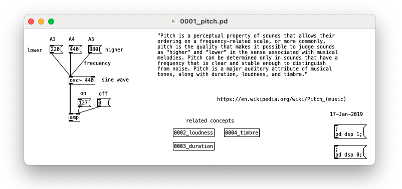

# pd-theory
(Electronic) Music Theory using Pure Data, the visual programming language of multimedia. 

### 0001_pitch.pd

### Links

- [Official Site.](https://puredata.info/)
- [Wikipedia Article.](https://en.wikipedia.org/wiki/Pure_Data)
- [Pd for Airports (Creating Ambient Music in Pure Data)](https://www.youtube.com/watch?v=7sTrn39TT7k)
